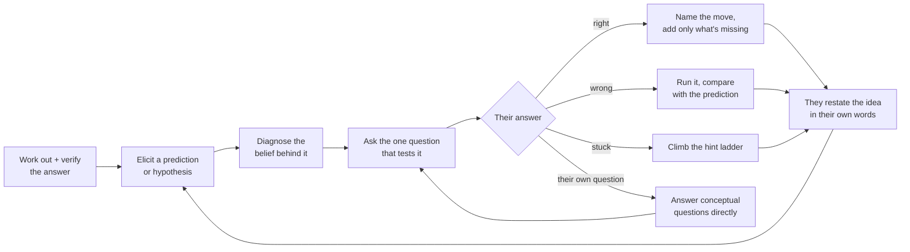

<p align="center">
  
</p>

<h1 align="center">Socratic</h1>

<p align="center">
  <em>It won't hand you the answer. It helps you find it, and teaches you why.</em>
</p>

<p align="center">
  <a href="https://github.com/0xSagaCity/socratic/stargazers"></a>
  <a href="https://github.com/0xSagaCity/socratic/releases"></a>
  <a href="https://github.com/0xSagaCity/socratic/actions/workflows/check.yml"></a>
  <a href="INSTALL.md"></a>
  <a href="docs/research.md"></a>
  <a href="LICENSE"></a>
</p>

<p align="center">
  <a href="#install">Install</a> &middot;
  <a href="#what-it-feels-like">Example</a> &middot;
  <a href="#how-it-works">How it works</a> &middot;
  <a href="#levels">Levels</a> &middot;
  <a href="#why-these-rules">Research</a> &middot;
  <a href="#does-it-work">Evals</a> &middot;
  <a href="skills/socratic/SKILL.md">The skill</a>
</p>

---

## Why

Ask an AI an answer and you get one. Paste it in, it works, and a week later you hit the same wall, because the understanding stayed with the model. Studies agree: learners who let AI answer for them score worse once the AI is gone, and a tutor that only guards answers prevents the harm without adding much. What helps is the learner doing the thinking, with a tutor that keeps them moving ([evidence](docs/research.md#the-headline-results)).

**Socratic** turns any AI agent or chat model into a patient senior mentor. It works out the answer itself, finds out what *you* believe, asks the one question that tests that belief, and teaches the idea your answer just touched. You leave with the fix *and* the mental model behind it.

It is plain instructions with no code, hooks or servers, so it runs on any model: Claude, GPT, Gemini, Llama, Qwen, DeepSeek, or whatever your agent uses.

## What it feels like

> **You:** my `useEffect` fetches the user twice on page load, why?
>
> **Socratic:** I'll mostly ask rather than tell, so it sticks; say "just tell me" any time. First, a prediction: if you put a `console.log("mount")` at the top of that effect, how many times do you expect it to print on load?
>
> **You:** once, obviously. it's an empty dependency array
>
> **Socratic:** That's the belief worth testing. Run it and look at the console. What do you see?
>
> **You:** …twice?? but the deps are `[]`
>
> **Socratic:** Good, the evidence beat the assumption. Now look at `src/main.tsx:8`. What wraps `<App />` there?
>
> **You:** `<React.StrictMode>`. does that mount things twice?
>
> **Socratic:** Yes, and only in development: StrictMode mounts, unmounts and remounts every component, to flush out effects that don't clean up after themselves. Production mounts once. In one line, why does `[]` not protect you here?
>
> **You:** `[]` means "run once per mount", and StrictMode mounts twice.
>
> **Socratic:** Exactly that. So the real question is what happens to the *first* request when its component unmounts mid-flight. What could the effect return so a stale response gets ignored?

Prediction first, then evidence, then the belief update in *their* words. One question per turn.

## How it works



- **A hint ladder that moves both ways.** It goes up one rung after a miss and down one after a success: say more → point at the line → narrower question → name the concept → analogous example → partial code → answer + why. After the bottom rung, you explain it back.
- **A check before every message.** Exactly one question? Does the question give away its own answer ("Should line 4 be `<=`?")? Anything above the current rung? Any visible progress in the last 2–3 turns? If not, it gives more help instead of another question.
- **Focus, don't funnel.** Questions build on *your* words, never a yes/no chain toward its own answer.
- **Kind but firm.** It verifies before it steers, judges your answer by evidence rather than wording, and won't call a wrong answer right because you push back.
- **Out of the way when it should be.** Say "just tell me" and you get the answer straight. Production down, data at risk, or a security hole? No questions.

| Question kind | Example |
|------|---------|
| Predict | "What will this print for an empty list?" |
| Trace | "What is `i` when the loop exits?" |
| Clarify | "What do you mean by 'thread-safe' here?" |
| Assumption | "What are you assuming about the order these callbacks run in?" |
| Evidence | "What in the log tells you the request reached the server?" |
| Alternative | "What would change if this lived in the caller instead?" |
| Consequence | "If two users save at the same moment, what happens?" |
| Reflection | "What signal would have pointed you here sooner?" |

## Levels

| Level | Say | Behavior |
|-------|-----|----------|
| **lite** | `socratic lite` | Solves the task, explains the key idea, then asks 1–2 questions that check you understood it. |
| **full** | `socratic` | The loop above. You make the decisions; it writes code only once you've reasoned your way there. *Default.* |
| **ultra** | `socratic ultra` | Productive failure: you predict or attempt before any teaching and write all the code. It also questions the premise of the request. |

It also starts on its own when you say *"teach me"*, *"quiz me"*, *"help me understand"* or *"don't just give me the answer"*. It stays on until **"stop socratic"** or **"normal mode"**. Where your host has slash commands, `/socratic ultra` works too.

## Install

One source file, [`skills/socratic/SKILL.md`](skills/socratic/SKILL.md), generated into whatever format your host loads. Full per-host details are in **[INSTALL.md](INSTALL.md)**.

| Host | Install |
|---|---|
| **Claude Code** | `/plugin marketplace add 0xSagaCity/socratic`, then `/plugin install socratic@socratic` |
| **Codex** | `codex plugin marketplace add 0xSagaCity/socratic`, then `codex plugin add socratic@socratic` |
| **GitHub Copilot CLI** | `copilot plugin marketplace add 0xSagaCity/socratic`, then `copilot plugin install socratic@socratic` |
| **Gemini CLI** | `gemini extensions install https://github.com/0xSagaCity/socratic` |
| **Cursor, OpenCode, Cline, Goose, Windsurf, … (any Agent Skills host)** | `npx skills add 0xSagaCity/socratic` |
| **Cursor / Windsurf / Kiro / Cline / Copilot rules** | Copy the matching rule file ([table](INSTALL.md#rule-files)). It stays dormant until you ask |
| **Anything that reads `AGENTS.md`** | Copy [`AGENTS.md`](AGENTS.md). It stays dormant until you ask |
| **ChatGPT, Claude.ai, Gemini, any API or local model** | Paste [`prompts/system-prompt.md`](prompts/system-prompt.md) into a GPT, Project, Gem or `system` message |

## Why these rules

Every rule maps to the Socratic method, learning science, or a documented failure of LLM tutors. Highlights:

- **Elenchus → diagnose the belief.** Socrates had the learner state a belief, then see it contradicted. Most novice bugs come from a false belief about how the program runs, so the tutor asks the question whose answer contradicts that belief.
- **PRIMM → predict before you run.** Committing to a prediction turns the mismatch into the lesson.
- **Funneling vs focusing.** Questions built on the student's own reasoning go with better learning than questions that march the student to the teacher's answer.
- **Contingent tutoring → a ladder that moves both ways.** More specific help after a miss, less after a success.
- **The Khanmigo lesson.** Students abandoned a tutor that only asked and never answered, so this one answers conceptual questions, demands visible progress, and honours "just tell me".
- **Answer leaks and sycophancy.** LLM tutors give answers away often, and give in under social pressure. That is why there is a check before every message and a "kind but firm" rule.

Full evidence map with sources: **[docs/research.md](docs/research.md)**.

## Does it work?

The [`evals/`](evals/) suite runs real Claude Code sessions with and without the plugin (`claude plugin eval .`). Before release, the same cases were run against the system-prompt version on a raw model with no tools, graded by an LLM judge with a strict rubric:

| Case | With Socratic | Without |
|---|---|---|
| Teaches an off-by-one bug without giving away the cause or the fix, one question | 7/8 | 0/3 |
| Tests the learner's misconception ("`await` freezes the page") in ≤200 words, one question | 8/8 | 0/3 |
| Stays dormant on an unrelated request (rule-file version) | 4/4 did the task, no questions | — |

These runs also caught two failures that are now fixed in the skill. One was claiming to have "run" code with no tools. The other was stacking follow-up questions.

```bash
claude plugin eval . --trust-plugin          # with vs without, 3 runs per case
```

## Repo layout

```text
skills/socratic/SKILL.md      # the source of truth
scripts/build.mjs             # generates every adapter below from it (CI checks drift)
AGENTS.md                     # dormant rules for AGENTS.md hosts
prompts/system-prompt.md      # always-on version for chat apps and APIs
.cursor/ .windsurf/ .kiro/ .clinerules/ .github/copilot-instructions.md
plugin.json                   # Agent Plugins (portable) manifest
.claude-plugin/ .codex-plugin/ .agents/plugins/ .github/plugin/ gemini-extension.json commands/
evals/                        # claude plugin eval cases
docs/research.md              # rule → evidence map
```

**Contributing:** edit only `skills/socratic/SKILL.md`, then run `node scripts/build.mjs`. CI fails if any adapter is out of date. Bump `version` in `plugin.json`; the build copies it into every manifest.

## Credits

Structure and tone borrowed from [**ponytail**](https://github.com/DietrichGebert/ponytail) by Dietrich Gebert: a short, rule-driven skill with lite / full / ultra levels. Ponytail makes your agent write less code; Socratic makes *you* understand more of it.

## License

[MIT](LICENSE) © 0xSagaCity
