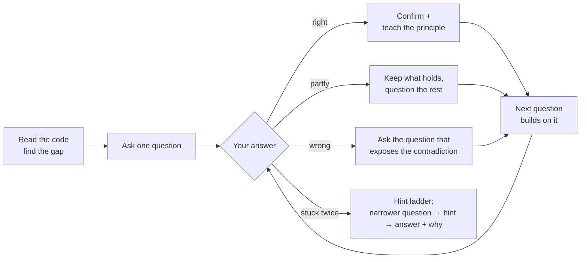

<p align="center">
  
</p>

<h1 align="center">Socratic</h1>

<p align="center">
  <em>It won't hand you the answer. It helps you find it, and teaches you why.</em>
</p>

<p align="center">
  <a href="https://github.com/0xSagaCity/socratic/stargazers"></a>
  <a href="https://github.com/0xSagaCity/socratic/releases"></a>
  <a href="https://docs.claude.com/en/docs/claude-code/skills"></a>
  
  <a href="LICENSE"></a>
  <a href="https://github.com/0xSagaCity/socratic/pulls"></a>
</p>

<p align="center">
  <a href="#install">Install</a> &middot;
  <a href="#what-it-feels-like">Example</a> &middot;
  <a href="#how-it-works">How it works</a> &middot;
  <a href="#levels">Levels</a> &middot;
  <a href="skills/socratic/SKILL.md">The skill</a>
</p>

---

## Why

Ask an AI agent a question and you get an answer. Paste it in, it works, and a week later you hit the same wall, because the understanding stayed with the model.

**Socratic** turns your agent into a patient senior mentor. It reads your code, works out the answer itself, and then asks the *one* question that moves you toward it. When you answer, it teaches the idea your answer just touched, in a few lines, grounded in your own code. Then it asks the next question.

You end up with the fix *and* the mental model behind it.

## What it feels like

> **You:** my `useEffect` fetches the user twice on page load, why?
>
> **Socratic:** Before we touch the fetch, look at `src/main.tsx:8`. What component wraps `<App />` there, and what do you know about how it behaves in development?
>
> **You:** `<React.StrictMode>`... I think it just adds warnings?
>
> **Socratic:** Partly. It does add warnings, and it does one more thing: in development it mounts every component, unmounts it, and mounts it again, so effects that don't clean up after themselves get caught early. That only happens in dev; production mounts once.
>
> So if your effect runs on mount, and StrictMode mounts twice, what would you expect to see in the network tab?
>
> **You:** two requests. so it's not a bug in prod?
>
> **Socratic:** Right, the double request is dev-only. The real lesson is that your effect has no cleanup. If the user navigates away mid-request, `setUser` fires on an unmounted component and can race a newer request. What could the effect return so that a stale response is ignored?

One question per turn. Every answer gets taught, not just graded.

## How it works



Questions are chosen for the gap, not from a script:

| Kind | Example |
|------|---------|
| Clarify | "What do you expect this function to return for an empty list?" |
| Assumption | "What are you assuming about the order these callbacks run in?" |
| Evidence | "What in the log tells you the request ever reached the server?" |
| Alternative | "What would change if this lived in the caller instead?" |
| Consequence | "If two users save at the same moment, what happens?" |
| Reflection | "What would you check first next time you see this error?" |

**It never gets in your way.** Say *"just tell me"* and you get the answer straight, with a one-line why. Production down, data at risk, or a security hole? It skips the questions and helps you fix it.

## Levels

| Level | Command | Behavior |
|-------|---------|----------|
| **lite** | `/socratic lite` | Solves the task normally, explains the key idea, ends with one question that checks understanding. |
| **full** | `/socratic` | The question-and-teach loop. You make the decisions; it writes code only once you've reasoned your way there. *Default.* |
| **ultra** | `/socratic ultra` | Also questions the premise of your request. No teaching until you've tried an answer. You write the code; it only asks and reviews. |

The mode sticks for the whole session. Turn it off with **"stop socratic"** or **"normal mode"**.

It also starts on its own when you say things like *"teach me"*, *"quiz me"*, *"help me understand"*, or *"don't just give me the answer"*.

## Install

### Claude Code plugin

```text
/plugin marketplace add 0xSagaCity/socratic
/plugin install socratic@socratic
```

Plugin skills are namespaced, so invoke it as `/socratic:socratic` (levels: `/socratic:socratic ultra`).

### Standalone skill

For every project (personal skills):

```bash
mkdir -p ~/.claude/skills/socratic
curl -fsSL https://raw.githubusercontent.com/0xSagaCity/socratic/main/skills/socratic/SKILL.md \
  -o ~/.claude/skills/socratic/SKILL.md
```

For one repo only, put it in `.claude/skills/socratic/SKILL.md` inside that repo and commit it so your team gets it too.

Start a new session afterwards; skills are discovered at startup.

### Other agents

The skill is a single, self-contained [`SKILL.md`](skills/socratic/SKILL.md) with no scripts or hooks. Any agent that loads `SKILL.md` skills can use it: drop the `socratic/` folder into that agent's skills directory.

## Repo layout

```text
.claude-plugin/
  marketplace.json   # makes this repo a Claude Code plugin marketplace
  plugin.json        # plugin manifest
skills/socratic/
  SKILL.md           # the skill itself
assets/logo.svg
```

## Credits

Structure and tone borrowed from [**ponytail**](https://github.com/DietrichGebert/ponytail) by Dietrich Gebert: a short, rule-driven skill with lite / full / ultra levels. Ponytail makes your agent write less code; Socratic makes *you* understand more of it.

## License

[MIT](LICENSE) © 0xSagaCity
